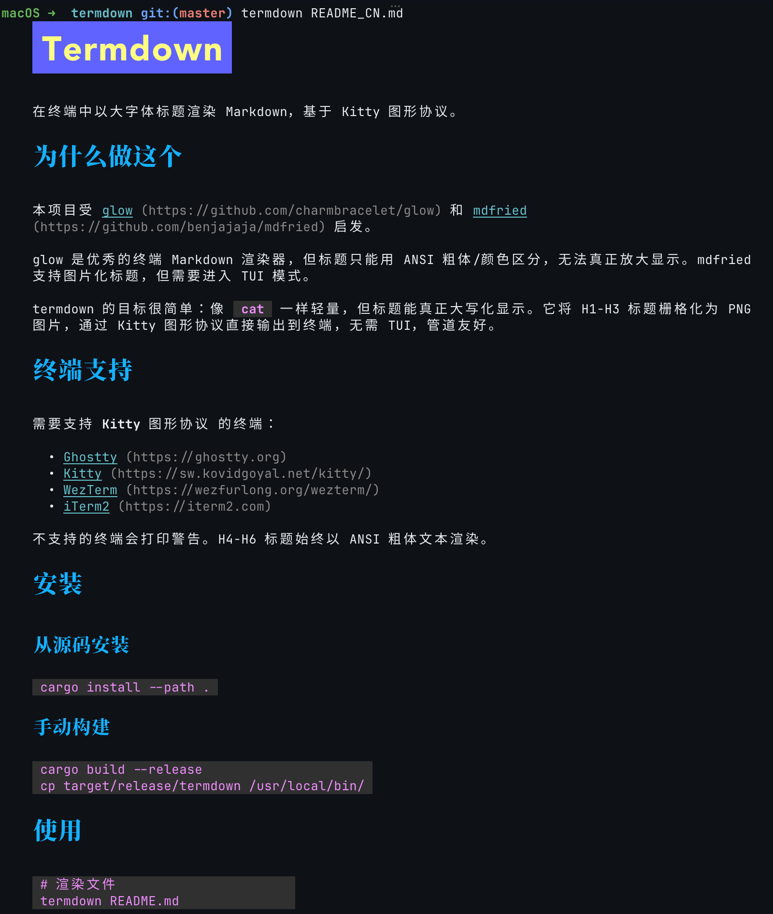
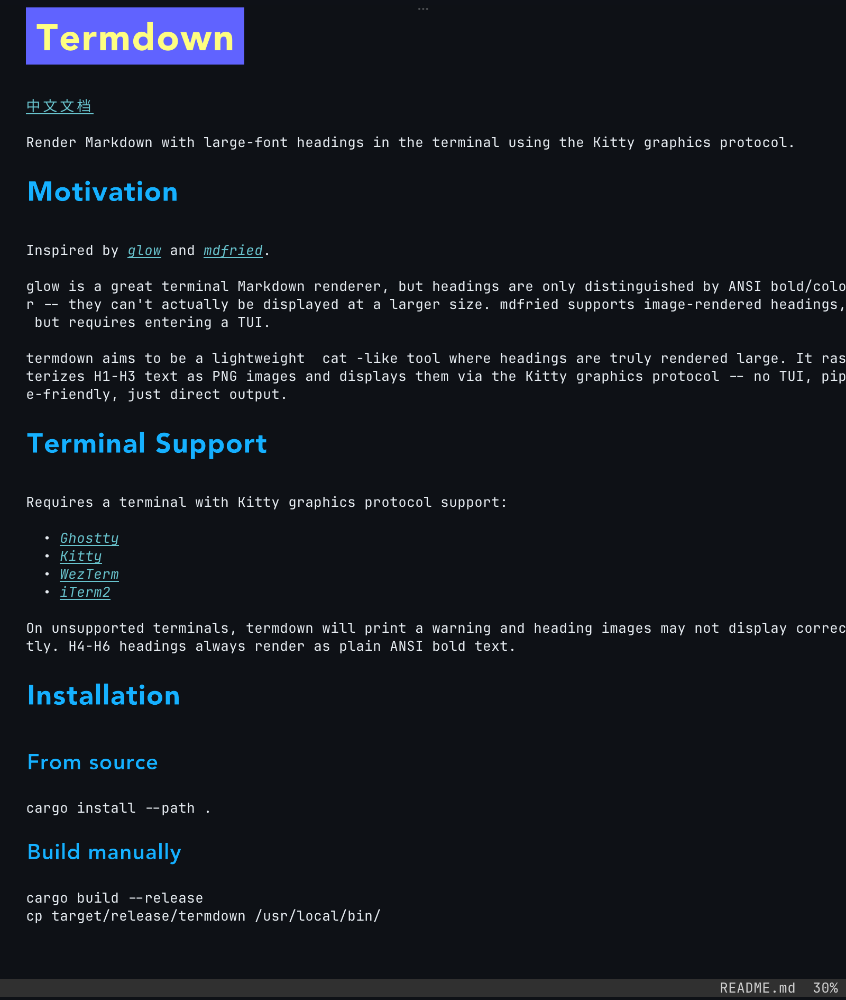

# Termdown

[中文文档](README_CN.md)

termdown uses the Kitty graphics protocol to render Markdown with large-font headings in the terminal, providing a reading experience closer to a GUI Markdown reader.

<table>
<tr>
<td></td>
<td></td>
</tr>
</table>

## Features

termdown rasterizes H1-H3 headings as PNG images and draws them directly in the terminal through the Kitty graphics protocol. It provides two modes:

- **Interactive TUI** (default) -- `termdown README.md` provides a vim/less-like experience with paging, search, a table of contents, and link navigation for longer documents.
- **Direct output** -- `termdown --cat README.md` prints rendered Markdown like `cat`, making it suitable for short documents. Piped or redirected output uses text headings instead of Kitty images.

H4-H6 headings always use ANSI bold text instead of simulating more font sizes and weights that could reduce readability in a terminal.

Fenced `mermaid` blocks, including flowcharts and sequence diagrams, render as diagrams in the TUI and in `--cat` on supported terminals. Diagrams follow the selected theme and scale to fit the available space. Pipes, redirects, and blocks that cannot be rendered show the Mermaid source.

## Installation

### Cargo

```sh
cargo install termdown
```

Installs into `~/.cargo/bin/`. Requires Rust 1.95+.

### Install script

**macOS / Linux:**

```sh
curl -fsSL https://raw.githubusercontent.com/rrbe/termdown/master/install.sh | bash
```

Installs to `/usr/local/bin` by default. Set `TERMDOWN_INSTALL_DIR` to override it.

**Windows (PowerShell):**

```powershell
powershell -ExecutionPolicy Bypass -c "irm https://github.com/rrbe/termdown/releases/latest/download/termdown-installer.ps1 | iex"
```

The macOS/Linux command is a compatibility wrapper: it understands both the new
cargo-dist archive layout and the legacy archive layout. The Windows installer
is available on releases built with cargo-dist. **To update, just re-run the
install command.**

Or, with [`cargo-binstall`](https://github.com/cargo-bins/cargo-binstall) (fetches the prebuilt binary, no compile):

```sh
cargo binstall termdown
```

<details>
<summary>Manual download</summary>

```sh
TARGET=aarch64-apple-darwin
BASE="https://github.com/rrbe/termdown/releases/latest/download"

curl -LO "${BASE}/termdown-${TARGET}.tar.xz"
curl -LO "${BASE}/termdown-${TARGET}.tar.xz.sha256"
shasum -a 256 -c "termdown-${TARGET}.tar.xz.sha256"

tar xf "termdown-${TARGET}.tar.xz"
sudo mv "termdown-${TARGET}/termdown" /usr/local/bin/
```

</details>

### Install from source

```sh
cargo install --git https://github.com/rrbe/termdown
```

## Uninstall

If you installed from crates.io:

```sh
cargo uninstall termdown
```

If you installed from the shell installer:

```sh
curl -fsSL https://raw.githubusercontent.com/rrbe/termdown/master/uninstall.sh | bash
```

Manual cleanup:

```sh
rm $(which termdown)
rm -rf ~/.config/termdown
```

## Usage

```sh
# Open a file in the interactive TUI (default)
termdown README.md

# Plain cat-style output (non-interactive, pipe-friendly)
termdown --cat README.md
cat notes.md | termdown

# Pick a theme; show help
termdown --theme light README.md
termdown --help

# Live preview: re-render on every save (edit in your editor, watch here)
termdown --watch notes.md
```

## Documentation

- [Usage guide](docs/USAGE.md)
- [Project overview](docs/OVERVIEW.md)
- Configuration and defaults: [`config.example.toml`](config.example.toml)
- Configuration file: `~/.config/termdown/config.toml`

## Terminal Support

Requires a terminal with **Kitty graphics protocol** support, such as:

- [Kitty](https://sw.kovidgoyal.net/kitty/)
- [iTerm2](https://iterm2.com)
- [Ghostty](https://ghostty.org)

## License

[Apache-2.0](LICENSE)
